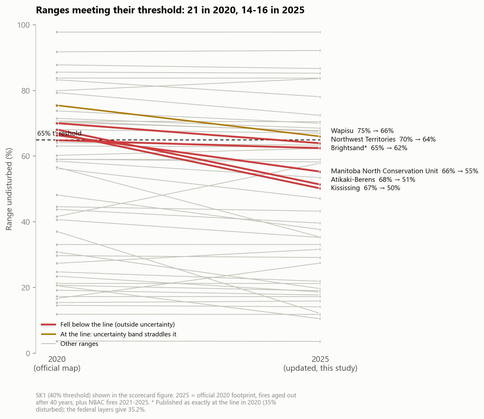
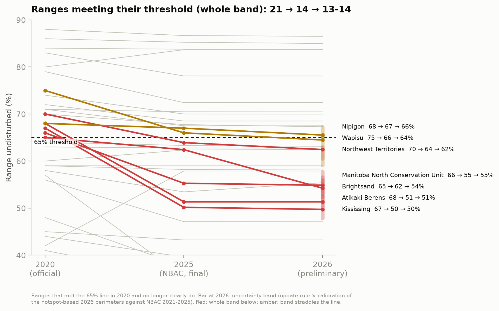
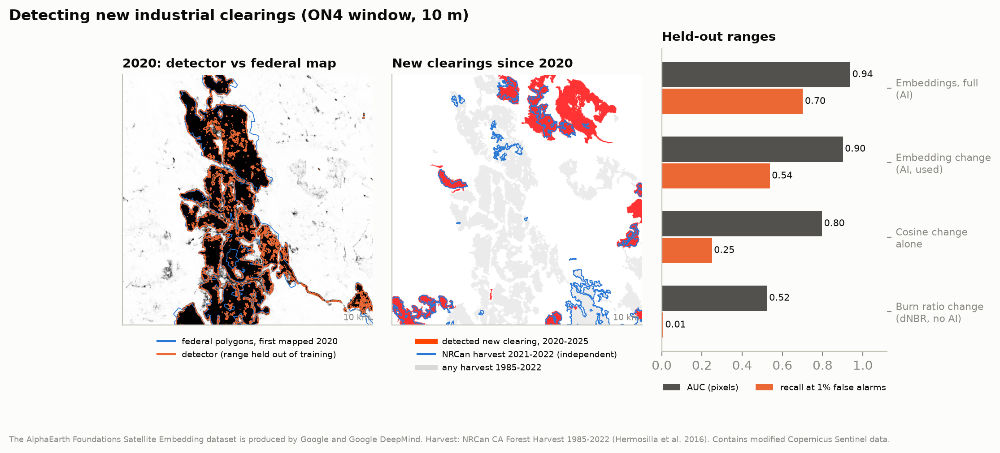

# Fire vs Caribou: updating Canada's boreal caribou habitat scorecard

Canada's recovery strategy for boreal caribou says each of the 51 ranges needs at least
65% of its area undisturbed (40% for Saskatchewan's Boreal Shield range, SK1). The
federal disturbance map stops in 2020. This project updates it through the record
2021-2025 fire seasons **with the method Canada uses**, reports which ranges have fallen
through the line, splits the loss into fire and industry, computes when each range
could recover on its own, and estimates the chance each range is below its threshold
in 2030.

STEM Fellowship National High School Big Data & AI Challenge 2026-27 (Canada West).
Idea, schedule and judging notes: [IDEA.md](IDEA.md).

<!-- RESULTS -->

## Results (first full run, 2026-11-17)

**21 of 51 ranges met their threshold on the 2020 federal map. After the 2021-2025 fires, 14-16 do.** 5 ranges fell through the line with their whole uncertainty band below it, including the Northwest Territories range, the largest in the country (441,665 km²).



| Measure | Result |
| --- | --- |
| Ranges meeting threshold, 2020 (published / our recomputation) | 21 / 20 (Brightsand is 35.2% disturbed in the federal layers, published as 35%) |
| Our 2020 recomputation vs the published per-range figures | within 0.5 points for all 51 (the report rounds to whole %) |
| Rebuilt 2020 footprint (buffered human + CNFDB 1981-2020) vs official layer | median difference 0.0001 points, max 0.16 |
| Ranges meeting threshold, 2025 (whole band above / band reaches threshold) | 14 / 16 |
| Range area burned 2021-2025 | 202,150 km² (8.3% of all range area) |
| ...of which was not already disturbed in 2020 | 120,273 km² |
| Returned to undisturbed as 1981-1985 fires aged out | 45,473 km² |
| Ranges with more than 10% burned in five years | 20 |
| Ranges that lost more than 10 points | 8 |
| Ranges meeting threshold under a human-only rule (no fire), 2020 | 32 |
| 100 m raster vs exact vector area of the official layers | max 0.02 points (2020), 0.02 (2015) |

### Ranges that crossed below their threshold

| Range | 2020 (official) | 2025 (headline) | 2025 band | Burned 2021-25 | Back above the line, no new disturbance | Chance below in 2030 |
| --- | --- | --- | --- | --- | --- | --- |
| Kississing (MB2) | 67% | 50% | 49%-52% | 34% | 2065 | 100% |
| Atikaki-Berens (MB12) | 68% | 51% | 50%-56% | 25% | 2052 | 100% |
| Manitoba North Conservation Unit (MB9) | 66% | 55% | 54%-58% | 17% | 2033 | 100% |
| Northwest Territories (NT1) | 70% | 64% | 63%-64% | 10% | 2027 | 100% |
| Brightsand (ON4) * | 65% | 62% | 62%-64% | 4% | 2036 | 100% |
| Saskatchewan Boreal Shield (SK1) (band straddles the line) | 43% | 40% | 35%-43% | 15% | meets now | 92% |
| Wapisu (MB8) (band straddles the line) | 75% | 66% | 62%-67% | 15% | meets now | 23% |

\* Brightsand was published as exactly at the line in 2020; the federal layers give 64.8% undisturbed. SK1's threshold is 40%.

### The recovery clock

With no new fire and no new industry, **16 ranges now below their threshold would recover on their own** as burns age out (2027-2065). **19 never would**: their human footprint alone keeps them below, and they need 57,412 km² of restoration in total (largest: Chinchaga 14,156 km², East Side Athabasca River 5,914 km², West Side Athabasca River 5,858 km²). 16 ranges meet their threshold today.


### 2030 outlook

Among ranges not already below their threshold, those with at least a 5% chance of being below it in 2030 (fire record 1986-2025; in brackets, the 2011-2025 record only): Saskatchewan Boreal Shield 92% (98%); Nipigon 77% (72%); Wapisu 23% (29%); Pagwachuan 19% (19%); North Interlake 12% (29%); Quebec 8% (11%).

The Northwest Territories range would be back above the line by 2027 if nothing else burned, but at its own 1986-2025 burn rate it is below the line in 100% of simulated 2030s (median 62%).

Figures: [scorecard with bands](outputs/figures/fig2_scorecard_bands.png) · [fire vs industry](outputs/figures/fig4_fire_vs_industry.png) · [2030 outlook](outputs/figures/fig5_forecast_2030.png) · [status map](outputs/figures/fig6_status_map.png) · [hero image](outputs/figures/fig0_hero_MB12.png). Full tables: [outputs/tables](outputs/tables).

**Not yet in these numbers:** industry built since 2020. The fire vs industry split projects it from the official 2015-2020 growth until the detector (below) maps it. Treat 2025 values as an upper bound on undisturbed habitat.

<!-- /RESULTS -->

## Update 2026-11-17: the 2026 fires, the fire-source check, the detector and triage

This section is written by hand. The block above is generated by `python -m caribou report`
from the 2025 tables and is unchanged. Where the two differ for a range (the NWT recovery
year, Brightsand), this section supersedes the block above for 2026.

**Ranges meeting their threshold with their whole uncertainty band: 21 (2020) → 14 (2025)
→ 13-14 (2026, preliminary).** Nipigon's 2026 band reaches 64.96%, 0.04 points under its
line. The 2026 season burned an estimated 32,800 km² of range (raw
hotspot estimate), mostly in the NWT, Quebec, Ontario and Saskatchewan ranges.



| Range | 2020 (published) | 2025 (band) | 2026 preliminary (band) | Burned in 2026 (estimate) | 2026 status | Back above the line, no new disturbance | Chance below in 2030 |
| --- | --- | --- | --- | --- | --- | --- | --- |
| Brightsand (ON4) | 65% | 62% (62-64) | **54% (52-57)** | 16.7% | below | 2066 | 100% |
| Northwest Territories (NT1) | 70% | 64% (63-64) | **62% (60-63)** | 3.2% | below | 2033 | 100% |
| Manitoba North (MB9) | 66% | 55% (54-58) | 55% (53-58) | 1.0% | below | 2033 | 100% |
| Atikaki-Berens (MB12) | 68% | 51% (50-56) | 51% (50-56) | 0% | below | 2052 | 100% |
| Kississing (MB2) | 67% | 50% (49-52) | 50% (48-52) | 1.2% | below | 2065 | 100% |
| Nipigon (ON5) | 68% | 67% (67-68) | **66% (65.0-67)** | 2.5% | **uncertain** (was meets) | meets | 100% |
| Wapisu (MB8) | 75% | 66% (62-67) | 64% (59-65) | 2.3% | uncertain | 2043 | 100% |
| Sask. Boreal Shield (SK1, 40% line) | 43% | 40% (35-43) | 40% (35-43) | 1.3% | uncertain | 2029 | 94% |

Notes on the table:
- Brightsand, the NWT, Nipigon, Wapisu and SK1 were rasterized with the 2026 layers on the
  100 m grid.
- The other ranges are bounded from the recovery trajectory and their burned share
  (`final_table.csv`, `method_2026`). No bounded range changes status, even at the worst
  bound; Quebec is the tightest, at 65.7% or higher.
- For the five rasterized ranges, the recovery and 2030 columns restart from 2026. The
  2030 chance uses the 2026 estimate at face value plus industry catch-up at the full
  2015-2020 pace, so it is pessimistic. For the other ranges these columns are the 2025
  values.
- Brightsand's "borderline 2020" caveat no longer matters. The Wabakimi fire took it far
  below the line (map: [fig9](outputs/figures/fig9_range_ON4.png)).

**Calibrating the 2026 estimate.** Inside the ranges, the hotspot-based perimeters cover
88-95% of what NBAC later mapped, but overstate it. NBAC confirms 0.74-0.86 of the
estimated area in every year 2021-2025 (pooled 0.76; `prelim2026_calibration.csv`). The 2026
estimate is scaled by its province's pooled ratio, and the band uses the lowest and highest
ratio of any sizeable range-year in that province (`prelim2026_factors.csv`).

**Fire source: the headline is conservative.** Inside the ranges, CNFDB agency perimeters
cover 4-11% more area than NBAC in 2021-2024 nationally, and up to 35% more in
Saskatchewan (`cnfdb_vs_nbac_2021_2024.csv`; CNFDB is incomplete for a few small
province-years: QC and ON 2022, NL 2023-24). The federal map was built from CNFDB, so the
NBAC-based update understates disturbance. Swapping in CNFDB for 2021-2024 lowers
Brightsand to 61.7% and SK1 to 38.9%. The NWT moves up by 0.02 points: CNFDB is not
larger everywhere, and in some province-years in QC and NL it covers less. It changes the
status of none of the five ranges re-rasterized with it, and it is part of their band.

**Reproducibility.** On a fresh download (2026-11-17), the rebuilt pixel tables reproduce
the committed 2025 values exactly (difference 0.00 points) for every range re-rasterized.

**Triage** (`final_table.csv`; recovery clock restarted from 2026:
[fig3_recovery_clock_2026](outputs/figures/fig3_recovery_clock_2026.png)):

| Triage | Ranges |
| --- | --- |
| Needs restoration | 19 ranges; 57,412 km² of buffered footprint to restore |
| Needs time | 16 ranges: below now, back above as burns age out |
| At risk | 6: SK1, Wapisu, Nipigon, Pagwachuan, North Interlake, Quebec |
| Secure | 10 ranges |

### The AI detector, run on open data (`caribou/detector/windows.py`)

The study used 22 windows of 10.24 km in industrial landscapes: 17 drawn at random (seed
2026) across 14 ranges in AB, BC, MB, NL, ON, QC and SK, plus the 5 blocks covering the
IDEA's Quebec pilot. Another 7 burn windows cover fresh burns, the main look-alike, for
19 ranges in all. Every score below is for ranges **held out of training**.



| | Embeddings, full (AI) | **Embedding change (AI, used)** | Cosine change alone | dNBR, same 3 years (no AI) |
| --- | --- | --- | --- | --- |
| Pixel AUC, federal 2020 labels (cleared vs intact + burned) | 0.94 | 0.90 | 0.80 | 0.52 |
| Pixel AUC, NRCan 2018-2020 harvests vs intact | - | 0.99 | - | 0.94 |
| Recall at 1% false alarms | 0.70 | 0.54 | 0.25 | 0.01 |
| Federal 2020 polygons ≥ 2 ha found (wall-to-wall) | 88% | 76% | 46% | 0% |
| False "new" clearings in 2020 (ha per 100 km²) | 105 | 19 | 0.5 | - |
| Independent: NRCan 2021-2022 harvest patches found | 30 of 39 | 30 of 39 | 67% | - |
| Quebec pilot blocks, pixel AUC | 0.99 | 0.97 | - | 0.56 |

- **The operating detector is the embedding-change model.** It finds as many independent
  2021-2022 harvests as the full model, with a fifth of its false alarms. The cosine
  change alone has fewer false alarms but misses half the clearings. False alarms matter
  because each one becomes a 500 m buffer.
- **Why the full model over-detects.** It also sees what a pixel looks like now. Of its
  2020 false alarms, 76% lie inside the existing 500 m footprint (along roads and seismic
  lines) and 37% on regrowing old burns.
- **How the variants were chosen.** The change-only model was added after the first two
  were run, and all are reported.
- **Where the classic index fails.** A burn-ratio change works on fresh harvests (0.94),
  but not on what the federal map adds: well sites, mines, and cut blocks from 2015-16
  that are already regrowing (a third of the 2020 polygons are not harvests at all).
  It also scores fresh burns higher than clearings. The IDEA pilot's single Landsat
  feature over six years reached 0.86 on the pilot area; the embedding model reaches
  0.97-0.99 there.

**Fire, not industry, drove the post-2020 loss.** Inside the 51 ranges:
- Fire burned about **40,400 km² per year** in 2021-2025 (24,100 km²/yr of it on ground
  not already disturbed).
- Harvest cleared about 1,100 km²/yr in 2015-2020 and 990 km² in 2021, from the
  selection-free NRCan harvest map (`harvest_by_range_year.csv`). Its 2022 value (700
  km²) is the map's final year and likely incomplete.
- So industry kept roughly its 2015-2020 pace (at most about 10% slower). The fire vs
  industry split, which projects that pace with the 500 m buffer, therefore stands: fire
  is 85% of post-2020 habitat loss.
- The detector windows suggest a sharper slowdown (about 0.4 of the 2015-2020 pace,
  `detector_pace.json`). The windows were drawn where 2015-2020 clearing was mapped, so
  that ratio is biased low by design. Do not quote it as a national pace.

## How it works

### The federal rule, rebuilt from its parts

The federal *total* disturbance footprint for 2020 (map service layer 3) is the union of

* human footprint visible on Landsat (roads, seismic lines, cutblocks, well sites, mines,
  ...) **buffered by 500 m** (layer 2), and
* **fire polygons from the Canadian National Fire Database (CNFDB), 1981-2020** (the
  service description says so explicitly).

We rebuilt that union ourselves from layer 2 and the CNFDB. Our rebuild and the official
layer 3 agree on 99.84-100% of pixels per range (median 99.9998%), so the inputs and the
40-year window are confirmed rather than assumed. The same rebuild for the 2015 edition
(fires 1976-2015) lands within 0.3 points of the official share for the median range;
agreement is lower there (down to 93% of pixels), most likely because the CNFDB has been
revised since the 2015 edition was built (not yet checked).

### The update rules (2025)

| Rule | Definition | Role |
| --- | --- | --- |
| `official_adj` | Official 2020 total, minus pixels whose only cause was a CNFDB fire now older than 40 years (1981-1985), plus NBAC fires 2021-2025 | **Headline** |
| `rebuild_cnfdb` | Official buffered human footprint + every fire in the 1986-2025 window (CNFDB to 2020, NBAC after) | Band |
| `rebuild_nbac` | Same, NBAC for every year | Band |
| `no_ageout` | Official 2020 total + new fires, nothing ages out | Band (upper bound on disturbance; not the federal rule) |
| 250 m grid | Headline rule on a 250 m instead of 100 m grid | Band |
| human-only | Buffered human footprint only, no fire | Sensitivity: "should fire count?" |

A range's **status** is *meets* if its whole band is at or above its threshold, *below* if
the whole band is under it, and *uncertain* otherwise. A **clear crossing** is a range
that met its threshold in 2020 (as published) and is *below* in 2025. Nothing inside the
band is headlined.

### One rasterization, every scenario

`caribou/pixels.py` burns every input once per range onto a 100 m grid in Canada Albers
Equal Area (each pixel is exactly 1 ha) and counts pixels per unique combination of
official footprint flags (2015, 2020) and last-fire year in each fire source. Because only
the *last* fire matters for a 40-year window, that small table answers every question in
the project by aggregation: the 2015 and 2020 reproductions, every update rule, the
human-only rule, the recovery clock, and the start state of the forecast. Tiling keeps
memory flat at any resolution; the same code runs at 30 m.

### Recovery clock

With no new fire and no new industry, a range's undisturbed share rises as burns age out
(a 2023 burn stops counting in 2063) up to a *ceiling* set by its human footprint. If the
ceiling clears the threshold, the range **recovers with time**, in a computable year. If
not, it **needs restoration**, of a computable area. This turns the fire vs industry split
into a policy result: which herds need time, and which need restoration.

### 2030 forecast

A Monte Carlo simulation, not a trained model. Each run adds human footprint at the
range's official 2015-2020 rate (×0.5-1.5 for uncertainty), also for 2021-2025 when the
detector has not mapped that period, and burns a share of the range each year drawn from
that range's own NBAC record (1986-2025; sensitivity: 2011-2025 only). Old fires age out
on schedule. Reported: the share of 20,000 runs below the threshold in 2030. Fires and
footprint are placed at random with respect to existing disturbance. Recent burns are in
reality less likely to reburn, so this understates new loss.

### Detector for post-2020 human disturbance (the AI component)

The federal map has no industry after 2020. `caribou/detector` trains a classifier
(intact / newly cleared / burned) on federal labels: polygons first mapped in 2020,
2016-2020 NBAC burns, and forest more than 500 m from any footprint and unburned since 1981.
It then applies the classifier to 2025. Two feature sets are compared on **held-out ranges**
(`GroupKFold` by range):

* **Google Satellite Embedding V1**: the 64-band annual embedding and its 3-year change;
* **Landsat summer indices**: NBR / NDVI / NDMI before, after, change, and the largest
  single-year NBR drop and its timing. The IDEA's one-feature pilot (NBR drop, AUC 0.86)
  is included as a baseline.

Detections of at least 2 ha (the federal minimum mapping unit) that touch no federal
polygon and lie mostly outside 2016-2025 fire perimeters are buffered by 500 m and fed
back into the scorecard as an extra footprint layer (`--new-human`). Narrow roads and
seismic lines are below the pixel size and out of scope. Feature extraction runs on
Google Earth Engine; labels, evaluation and post-processing run locally.

**The same detector without an Earth Engine account** (`caribou/detector/windows.py`, the
version whose results are reported above). Google's embeddings are also published as
open Cloud-Optimized GeoTIFFs (Source Cooperative, CC-BY 4.0). Reading them for 2.4 million
km² is not practical on a laptop, so the detector is trained and tested in a seeded random
sample of 10.24 km windows:

* **Windows.** Whole embedding blocks lying wholly inside one range, each counted only in
  the UTM zone that holds its centre. Each holds at least 10 federal polygons first mapped
  in 2020. Three are drawn per province (seed 2026), plus the blocks covering the IDEA's
  Quebec pilot. The rule was fixed before any result was seen.
* **Features.** The embedding in year Y, its change since Y-3, and the cosine change, at
  10 m. Values are de-quantized as Google documents. The COGs are stored bottom-up; the
  orientation was checked against federal cutblocks.
* **Model and validation.** Gradient-boosted trees. Labels as above, at pixel level.
  Validation is on held-out ranges: pixel AUC, recall at a 1% false-alarm rate, and
  wall-to-wall polygon detection after post-processing (patches of at least 2 ha; pixels
  on mapped polygons removed with a 20 m margin; mostly-burned patches removed).
* **Independent check.** NRCan's CA Forest Harvest 1985-2022, a Landsat harvest-year map
  never used in training: recall of 2021-2022 harvests, and a floor on precision.
* **Baseline without AI.** Sentinel-2 dNBR over the same 3 years.
* **Application.** The model is applied at Y = 2023 and Y = 2025, covering 2020-2025. The
  new clearings test whether industry kept its 2015-2020 pace in sampled industrial
  landscapes. They are not per-range estimates and are not fed into the national
  scorecard.

### Preliminary 2026 and the fire-source check (`caribou/prelim.py`)

The 2026 season (over on 2026-10-15) has no NBAC yet; NBAC 2026 is expected about May 2027.
CWFIS publishes a hotspot-based *Fire Perimeter Estimate*, which its own metadata calls
"very rough estimates ... best suited for large fires". It is therefore calibrated against
NBAC 2021-2025 inside the ranges:

* **Calibration.** The ratio of NBAC area to estimated area, by province: pooled for the
  central value, and the lowest and highest sizeable range-year for the band.
* **2026 scoring.** The 2026 estimate is rasterized as an extra mask on the same 100 m
  grid for the ranges where it can change the answer. Each is scored for 2026 under every
  update rule, with fires of 1986 ageing out.
* **Fire-source rule.** An extra update rule swaps CNFDB perimeters in for 2021-2024. The
  federal map used CNFDB, and NBAC maps less burned area than agency perimeters
  (Skakun et al. 2022).
* **Recovery and outlook.** The recovery clock and the 2030 outlook restart from 2026,
  with the estimate at face value, which is an upper bound on the 2026 burn.

`python -m caribou.synthesis` merges everything into `outputs/tables/final_table.csv`,
with a triage per range:

| Triage | Meaning |
| --- | --- |
| needs restoration | Below the threshold, and stays below after every fire ages out |
| needs time | Below the threshold, but recovers as burns age out |
| at risk | Meets now, but has at least a 5% chance of being below in 2030 |
| secure | Meets now, with under a 5% chance of being below in 2030 |

## Running it

```bash
pip install -e .[dev]          # Python 3.10+; geopandas, rasterio, scikit-learn, ...
python -m caribou all          # fetch -> prepare -> pixels -> vector -> analyze -> figures
python -m pytest               # synthetic-world tests with hand-computed answers
```

| Step | What it does | Time (laptop, 12 cores) |
| --- | --- | --- |
| `fetch` | Federal 2015 + 2020 layers (ArcGIS REST, paged by OBJECTID), NBAC 1972-2025, CNFDB | ~10 min, 2.5 GB |
| `prepare` | Reproject to Canada Albers, repair geometry, keep fires touching a range | ~15 min |
| `pixels` | Pixel-class tables per range at 100 m (+250 m for the band) | ~20-60 min |
| `vector` | Exact vector shares of the official layers (resolution check) | ~10 min |
| `analyze` | Scorecard, split, recovery, forecast tables | ~1 min |
| `figures` | Poster and manuscript figures | seconds |

Hero image (Sentinel-2 via Microsoft Planetary Computer, no account needed):
`python -c "from caribou.hero import hero; hero('MB12')"`.

Detector (needs `earthengine authenticate` and a Cloud project with Earth Engine enabled):

```bash
python -m caribou.detector labels
python -m caribou.detector sample --kind both --project <project>
python -m caribou.detector evaluate
python -m caribou.detector apply --kind emb --project <project>
python -m caribou.detector postprocess
python -m caribou pixels analyze figures --new-human detector_new_buffered
```

Detector on open data, with no account needed (about 2 GB of embedding blocks, ~1 h on a
laptop):

```bash
python -m caribou.detector.windows select download labels samples run dnbr baseline figure
```

Preliminary 2026, fire-source check and synthesis (after `fetch prepare`):

```bash
python -m caribou.prelim fetch prepare calibrate completeness
python -m caribou.prelim pixels --codes ON4 NT1 MB8 ON5 SK1   # the ranges 2026 can flip
python -m caribou.prelim analyze
python -m caribou.synthesis                                   # final_table.csv, fig7
```

When NBAC 2026 is published (about May 2027), set `UPDATE_YEAR = 2026` and re-run the main
pipeline: the 2026 column then becomes final.

The notebook [notebooks/scorecard.ipynb](notebooks/scorecard.ipynb) runs the same
steps and shows the tables. **To update next year**, set `UPDATE_YEAR` in
`caribou/config.py`, delete `data/raw/nbac` and `data/interim/pixels`, and re-run.

## Repository

```
caribou/            the pipeline (config, fetch, prepare, pixels, scenarios, scorecard,
                    recovery, forecast, figures, hero, prelim, synthesis, detector/)
caribou/detector/   Earth Engine detector + windows.py (the same detector on open COGs)
reference/          published federal 2020 per-range figures we reconcile against
manuscript/         outline and verified references for the paper
outputs/tables/     scorecard.csv, reproduction, split, recovery, forecast, summary.json,
                    prelim2026*.csv, final_table.csv, detector_*windows*.csv/json
outputs/figures/    fig0-fig8 (PNG + SVG)
notebooks/          re-runnable notebook
tests/              synthetic-world tests
data/               downloads and intermediates (git-ignored; rebuilt by `fetch prepare`)
```

## Data (all open)

| Dataset | Use |
| --- | --- |
| ECCC, *Anthropogenic disturbance footprint within boreal caribou ranges*, 2020 and 2015 editions (ArcGIS REST: `DisturbanceFootprintUpdatedFor2020`, `...For2015`) | Ranges, buffered human footprint, official totals, detector labels |
| NRCan, Canadian National Fire Database polygons (`NFDB_poly`, 1972-2020 file) | The fire record inside the federal baseline |
| NRCan, National Burned Area Composite, yearly 1972-2025 (version 20260513) | Fires 2021-2025; annual burn record for the forecast |
| ECCC 2024 progress report, Figure 2 data (`reference/`) | Published 2020 per-range figures |
| Copernicus Sentinel-2 L2A (Microsoft Planetary Computer) | Hero image |
| Google Satellite Embedding V1; Landsat Collection 2 L2 (Earth Engine) | Detector features |
| JRC Global Surface Water | Water mask for the detector |
| Google Satellite Embedding V1, COG copy on Source Cooperative (`tge-labs/aef`, CC-BY 4.0) | Detector on open data. "The AlphaEarth Foundations Satellite Embedding dataset is produced by Google and Google DeepMind." |
| NRCan CWFIS Fire M3 *Fire Perimeter Estimate*, 2026 and archive 2021-2025 | Preliminary 2026 fires; calibration |
| NRCan CNFDB 2021-2024 file (`NFDB_poly_2021to2024`) | Fire-source check |
| NRCan CA Forest Harvest 1985-2022 (Hermosilla et al. 2016) | Independent check of detected clearings |
