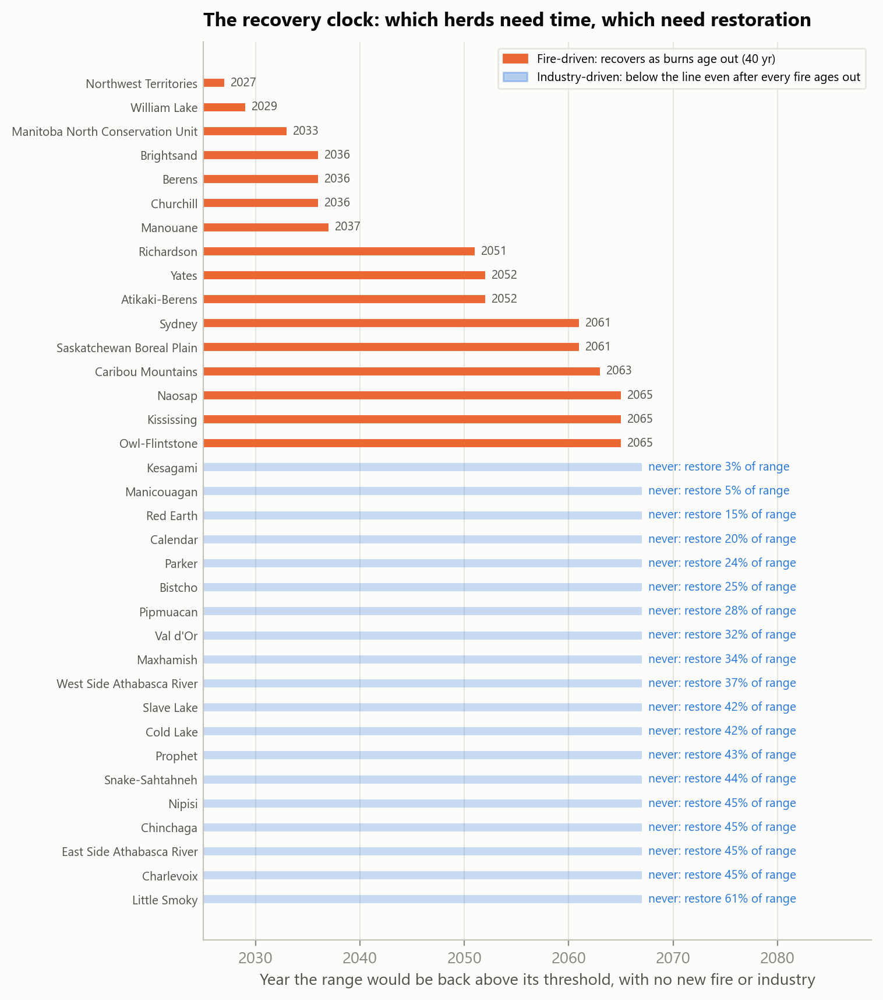

# Fire vs Caribou: updating Canada's boreal caribou habitat scorecard

Canada's recovery strategy for boreal caribou says each of the 51 ranges needs at least
65% of its area undisturbed (40% for Saskatchewan's Boreal Shield range, SK1). The
federal disturbance map stops in 2020. This project updates it through the record
2021-2025 fire seasons **with the method Canada uses**, reports which ranges have fallen
through the line, splits the loss into fire and industry, computes when each range
could recover on its own, and estimates the chance each range is below its threshold
in 2030.

STEM Fellowship National High School Big Data & AI Challenge 2026-27 (Canada West).
Idea, schedule and judging notes: [IDEA.md](IDEA.md).

<!-- RESULTS -->

## Results (first full run, 2026-11-17)

**21 of 51 ranges met their threshold on the 2020 federal map. After the 2021-2025 fires, 14-16 do.** 5 ranges fell through the line with their whole uncertainty band below it, including the Northwest Territories range, the largest in the country (441,665 km²).


| Measure | Result |
| --- | --- |
| Ranges meeting threshold, 2020 (published / our recomputation) | 21 / 20 (Brightsand is 35.2% disturbed in the federal layers, published as 35%) |
| Our 2020 recomputation vs the published per-range figures | within 0.5 points for all 51 (the report rounds to whole %) |
| Rebuilt 2020 footprint (buffered human + CNFDB 1981-2020) vs official layer | median difference 0.0001 points, max 0.16 |
| Ranges meeting threshold, 2025 (whole band above / band reaches threshold) | 14 / 16 |
| Range area burned 2021-2025 | 202,150 km² (8.3% of all range area) |
| ...of which was not already disturbed in 2020 | 120,273 km² |
| Returned to undisturbed as 1981-1985 fires aged out | 45,473 km² |
| Ranges with more than 10% burned in five years | 20 |
| Ranges that lost more than 10 points | 8 |
| Ranges meeting threshold under a human-only rule (no fire), 2020 | 32 |
| 100 m raster vs exact vector area of the official layers | max 0.02 points (2020), 0.02 (2015) |

### Ranges that crossed below their threshold

| Range | 2020 (official) | 2025 (headline) | 2025 band | Burned 2021-25 | Back above the line, no new disturbance | Chance below in 2030 |
| --- | --- | --- | --- | --- | --- | --- |
| Kississing (MB2) | 67% | 50% | 49%-52% | 34% | 2065 | 100% |
| Atikaki-Berens (MB12) | 68% | 51% | 50%-56% | 25% | 2052 | 100% |
| Manitoba North Conservation Unit (MB9) | 66% | 55% | 54%-58% | 17% | 2033 | 100% |
| Northwest Territories (NT1) | 70% | 64% | 63%-64% | 10% | 2027 | 100% |
| Brightsand (ON4) * | 65% | 62% | 62%-64% | 4% | 2036 | 100% |
| Saskatchewan Boreal Shield (SK1) (band straddles the line) | 43% | 40% | 35%-43% | 15% | meets now | 92% |
| Wapisu (MB8) (band straddles the line) | 75% | 66% | 62%-67% | 15% | meets now | 23% |

\* Brightsand was published as exactly at the line in 2020; the federal layers give 64.8% undisturbed. SK1's threshold is 40%.

### The recovery clock

With no new fire and no new industry, **16 ranges now below their threshold would recover on their own** as burns age out (2027-2065). **19 never would**: their human footprint alone keeps them below, and they need 57,412 km² of restoration in total (largest: Chinchaga 14,156 km², East Side Athabasca River 5,914 km², West Side Athabasca River 5,858 km²). 16 ranges meet their threshold today.



### 2030 outlook

Among ranges not already below their threshold, those with at least a 5% chance of being below it in 2030 (fire record 1986-2025; in brackets, the 2011-2025 record only): Saskatchewan Boreal Shield 92% (98%); Nipigon 77% (72%); Wapisu 23% (29%); Pagwachuan 19% (19%); North Interlake 12% (29%); Quebec 8% (11%).

The Northwest Territories range would be back above the line by 2027 if nothing else burned, but at its own 1986-2025 burn rate it is below the line in 100% of simulated 2030s (median 62%).

Figures: [scorecard with bands](outputs/figures/fig2_scorecard_bands.png) · [fire vs industry](outputs/figures/fig4_fire_vs_industry.png) · [2030 outlook](outputs/figures/fig5_forecast_2030.png) · [status map](outputs/figures/fig6_status_map.png) · [hero image](outputs/figures/fig0_hero_MB12.png). Full tables: [outputs/tables](outputs/tables).

**Not yet in these numbers:** industry built since 2020. The fire vs industry split projects it from the official 2015-2020 growth until the detector (below) maps it. Treat 2025 values as an upper bound on undisturbed habitat.

<!-- /RESULTS -->

## How it works

### The federal rule, rebuilt from its parts

The federal *total* disturbance footprint for 2020 (map service layer 3) is the union of

* human footprint visible on Landsat (roads, seismic lines, cutblocks, well sites, mines,
  ...) **buffered by 500 m** (layer 2), and
* **fire polygons from the Canadian National Fire Database (CNFDB), 1981-2020** (the
  service description says so explicitly).

We rebuilt that union ourselves from layer 2 and the CNFDB. Our rebuild and the official
layer 3 agree on 99.84-100% of pixels per range (median 99.9998%), so the inputs and the
40-year window are confirmed rather than assumed. The same rebuild for the 2015 edition
(fires 1976-2015) lands within 0.3 points of the official share for the median range;
agreement is lower there (down to 93% of pixels), most likely because the CNFDB has been
revised since the 2015 edition was built (not yet checked).

### The update rules (2025)

| Rule | Definition | Role |
| --- | --- | --- |
| `official_adj` | Official 2020 total, minus pixels whose only cause was a CNFDB fire now older than 40 years (1981-1985), plus NBAC fires 2021-2025 | **Headline** |
| `rebuild_cnfdb` | Official buffered human footprint + every fire in the 1986-2025 window (CNFDB to 2020, NBAC after) | Band |
| `rebuild_nbac` | Same, NBAC for every year | Band |
| `no_ageout` | Official 2020 total + new fires, nothing ages out | Band (upper bound on disturbance; not the federal rule) |
| 250 m grid | Headline rule on a 250 m instead of 100 m grid | Band |
| human-only | Buffered human footprint only, no fire | Sensitivity: "should fire count?" |

A range's **status** is *meets* if its whole band is at or above its threshold, *below* if
the whole band is under it, and *uncertain* otherwise. A **clear crossing** is a range
that met its threshold in 2020 (as published) and is *below* in 2025. Nothing inside the
band is headlined.

### One rasterization, every scenario

`caribou/pixels.py` burns every input once per range onto a 100 m grid in Canada Albers
Equal Area (each pixel is exactly 1 ha) and counts pixels per unique combination of
official footprint flags (2015, 2020) and last-fire year in each fire source. Because only
the *last* fire matters for a 40-year window, that small table answers every question in
the project by aggregation: the 2015 and 2020 reproductions, every update rule, the
human-only rule, the recovery clock, and the start state of the forecast. Tiling keeps
memory flat at any resolution; the same code runs at 30 m.

### Recovery clock

With no new fire and no new industry, a range's undisturbed share rises as burns age out
(a 2023 burn stops counting in 2063) up to a *ceiling* set by its human footprint. If the
ceiling clears the threshold, the range **recovers with time**, in a computable year. If
not, it **needs restoration**, of a computable area. This turns the fire vs industry split
into a policy result: which herds need time, and which need restoration.

### 2030 forecast

A Monte Carlo simulation, not a trained model. Each run adds human footprint at the
range's official 2015-2020 rate (×0.5-1.5 for uncertainty), also for 2021-2025 when the
detector has not mapped that period, and burns a share of the range each year drawn from
that range's own NBAC record (1986-2025; sensitivity: 2011-2025 only). Old fires age out
on schedule. Reported: the share of 20,000 runs below the threshold in 2030. Fires and
footprint are placed at random with respect to existing disturbance. Recent burns are in
reality less likely to reburn, so this understates new loss.

### Detector for post-2020 human disturbance (the AI component)

The federal map has no industry after 2020. `caribou/detector` trains a classifier
(intact / newly cleared / burned) on federal labels: polygons first mapped in 2020,
2016-2020 NBAC burns, and forest more than 500 m from any footprint and unburned since 1981.
It then applies the classifier to 2025. Two feature sets are compared on **held-out ranges**
(`GroupKFold` by range):

* **Google Satellite Embedding V1**: the 64-band annual embedding and its 3-year change;
* **Landsat summer indices**: NBR / NDVI / NDMI before, after, change, and the largest
  single-year NBR drop and its timing. The IDEA's one-feature pilot (NBR drop, AUC 0.86)
  is included as a baseline.

Detections of at least 2 ha (the federal minimum mapping unit) that touch no federal
polygon and lie mostly outside 2016-2025 fire perimeters are buffered by 500 m and fed
back into the scorecard as an extra footprint layer (`--new-human`). Narrow roads and
seismic lines are below the pixel size and out of scope. Feature extraction runs on
Google Earth Engine; labels, evaluation and post-processing run locally.

## Running it

```bash
pip install -e .[dev]          # Python 3.10+; geopandas, rasterio, scikit-learn, ...
python -m caribou all          # fetch -> prepare -> pixels -> vector -> analyze -> figures
python -m pytest               # synthetic-world tests with hand-computed answers
```

| Step | What it does | Time (laptop, 12 cores) |
| --- | --- | --- |
| `fetch` | Federal 2015 + 2020 layers (ArcGIS REST, paged by OBJECTID), NBAC 1972-2025, CNFDB | ~10 min, 2.5 GB |
| `prepare` | Reproject to Canada Albers, repair geometry, keep fires touching a range | ~15 min |
| `pixels` | Pixel-class tables per range at 100 m (+250 m for the band) | ~20-60 min |
| `vector` | Exact vector shares of the official layers (resolution check) | ~10 min |
| `analyze` | Scorecard, split, recovery, forecast tables | ~1 min |
| `figures` | Poster and manuscript figures | seconds |

Hero image (Sentinel-2 via Microsoft Planetary Computer, no account needed):
`python -c "from caribou.hero import hero; hero('MB12')"`.

Detector (needs `earthengine authenticate` and a Cloud project with Earth Engine enabled):

```bash
python -m caribou.detector labels
python -m caribou.detector sample --kind both --project <project>
python -m caribou.detector evaluate
python -m caribou.detector apply --kind emb --project <project>
python -m caribou.detector postprocess
python -m caribou pixels analyze figures --new-human detector_new_buffered
```

The notebook [notebooks/scorecard.ipynb](notebooks/scorecard.ipynb) runs the same
steps and shows the tables. **To update next year**, set `UPDATE_YEAR` in
`caribou/config.py`, delete `data/raw/nbac` and `data/interim/pixels`, and re-run.

## Repository

```
caribou/            the pipeline (config, fetch, prepare, pixels, scenarios, scorecard,
                    recovery, forecast, figures, hero, detector/)
reference/          published federal 2020 per-range figures we reconcile against
outputs/tables/     scorecard.csv, reproduction, split, recovery, forecast, summary.json
outputs/figures/    fig0-fig6 (PNG + SVG)
notebooks/          re-runnable notebook
tests/              synthetic-world tests
data/               downloads and intermediates (git-ignored; rebuilt by `fetch prepare`)
```

## Data (all open)

| Dataset | Use |
| --- | --- |
| ECCC, *Anthropogenic disturbance footprint within boreal caribou ranges*, 2020 and 2015 editions (ArcGIS REST: `DisturbanceFootprintUpdatedFor2020`, `...For2015`) | Ranges, buffered human footprint, official totals, detector labels |
| NRCan, Canadian National Fire Database polygons (`NFDB_poly`, 1972-2020 file) | The fire record inside the federal baseline |
| NRCan, National Burned Area Composite, yearly 1972-2025 (version 20260513) | Fires 2021-2025; annual burn record for the forecast |
| ECCC 2024 progress report, Figure 2 data (`reference/`) | Published 2020 per-range figures |
| Copernicus Sentinel-2 L2A (Microsoft Planetary Computer) | Hero image |
| Google Satellite Embedding V1; Landsat Collection 2 L2 (Earth Engine) | Detector features |
| JRC Global Surface Water | Water mask for the detector |
