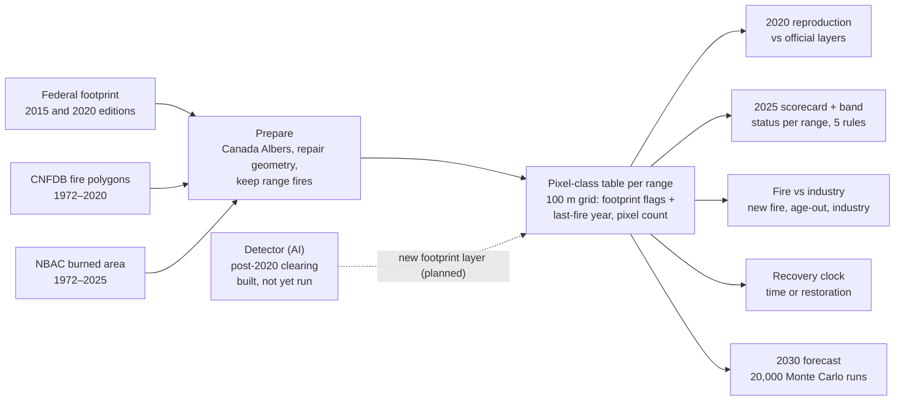
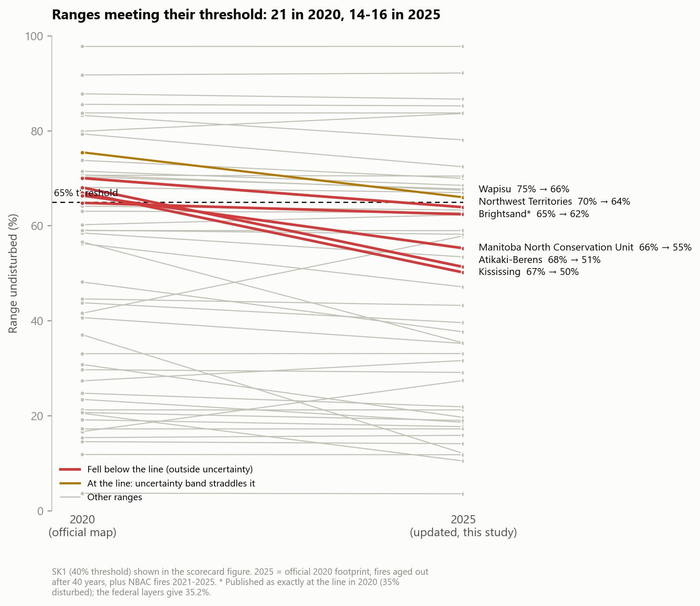
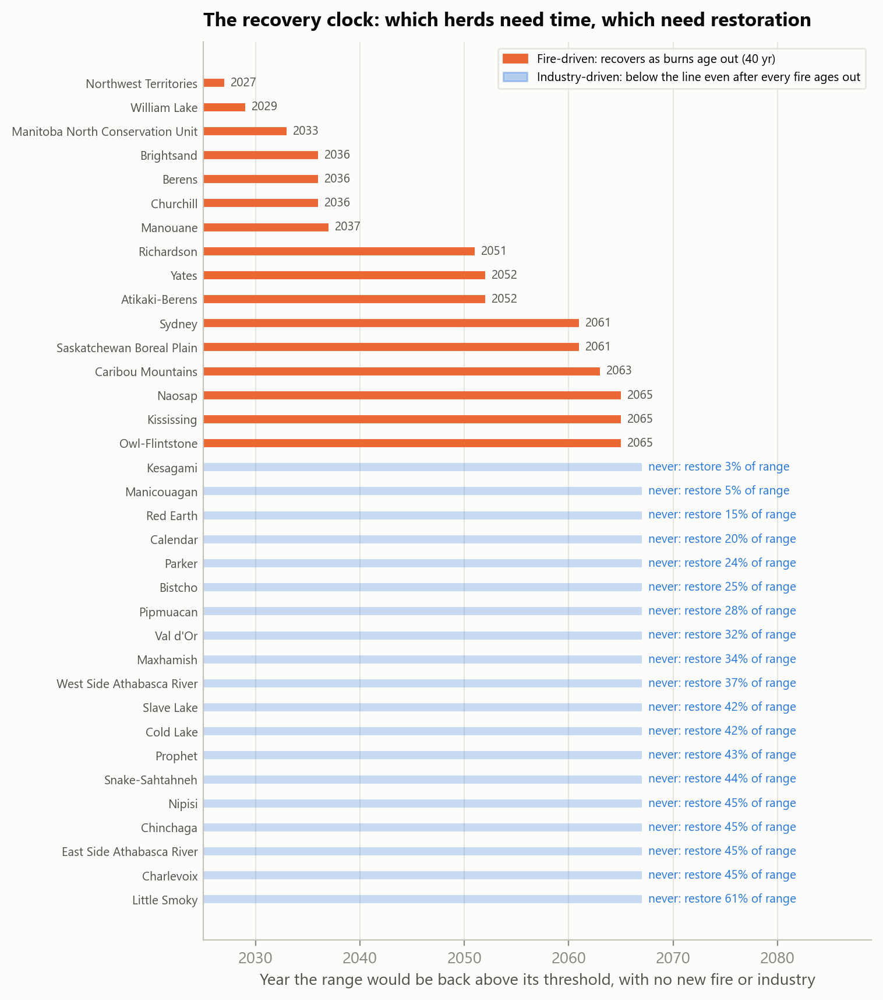

# Fire vs Caribou: updating Canada's boreal caribou habitat scorecard through the 2021–2025 fire seasons

Draft, 2026-11-18. Living copy (with interactive figures): https://claude.ai/artifact/KC4ch8fb4vazoS3b2j1ZTs

## Abstract

After the 2021–2025 fire seasons, only 14 to 16 of Canada's 51 boreal caribou ranges still meet their federal habitat threshold, down from 21 on the official 2020 map. Under the federal recovery strategy, each range needs at least 65% of its area undisturbed (40% for Saskatchewan's Boreal Shield range). Disturbance means human footprint buffered by 500 m plus fires of the last 40 years. The national disturbance map stops in 2020.

We rebuilt the federal 2020 footprint from its published parts and matched the official layer on a median 99.9998% of pixels per range. Our 2020 per-range values fall within 0.5 points of the published figures for all 51 ranges. We then updated the map to 2025 with the same rule: 1981–1985 fires age out, and National Burned Area Composite (NBAC) perimeters for 2021–2025 are added. Each range gets an uncertainty band from five alternative rules and grids, and only crossings outside the band are reported.

Fires burned 202,150 km² of range area in five years (8.3%), of which 120,273 km² was not already disturbed. Five ranges crossed below their threshold with the whole band below it: Kississing, Atikaki-Berens, Manitoba North, Northwest Territories (the largest range, 441,665 km²) and Brightsand. A recovery clock shows that, with no new disturbance, 16 ranges now below threshold would recover as burns age out (2027–2065). Another 19 never would, because human footprint alone keeps them below; together they need 57,412 km² of restoration. A Monte Carlo forecast puts Saskatchewan Boreal Shield (92%) and Nipigon (77%) most at risk of falling below by 2030. Industry built since 2020 is not yet mapped, so the 2025 values are an upper bound on undisturbed habitat. The pipeline is open and re-runs each year.

## 1. Introduction

Canada measures boreal caribou habitat with one number per range: the share of the range left undisturbed. The federal recovery strategy under the Species at Risk Act sets a threshold of 65% undisturbed for each of the 51 ranges, with one exception: 40% for Saskatchewan's Boreal Shield range (SK1). On the most recent federal data, for 2020, 21 of 51 ranges meet their threshold (ECCC, 2024).

The federal definition of disturbance has two parts. Human footprint visible on Landsat imagery (roads, seismic lines, cutblocks, well sites, mines) is buffered by 500 m. Areas burned in the last 40 years are added. The map has been updated every five years (2010, 2015, 2020), and the 2020 edition was published in 2024, four years after its data year.

Since 2020, the boreal forest has had some of the largest fire seasons on record, notably 2023 and 2025. Regional counts of burned caribou habitat exist for Alberta and British Columbia. We found no national update that applies the federal method range by range. Without one, range plans, Indigenous governments and conservation groups are working from a scorecard that predates the fires.

This paper fills that gap. It asks five questions:

1. How many of the 51 ranges meet their threshold after the 2021–2025 fires, and which crossed the line?
2. How much of the habitat lost since 2020 came from fire, and how much from industry?
3. When would each range cross back above its threshold if nothing else burned and nothing else was built?
4. Which ranges are most likely to be below their threshold in 2030?
5. Can a satellite classifier map new human disturbance since 2020, which the federal map does not yet include?

Our contributions are a verified rebuild of the federal 2020 footprint; a 2025 scorecard with per-range uncertainty bands; a recovery clock that separates ranges that need time from ranges that need restoration; a 2030 risk forecast; and an open pipeline that can be re-run each year. The detector for question 5 is built but not yet evaluated, and is reported as work in progress.

## 2. Data

All inputs are open federal or public datasets. The 51 ranges cover 2,445,730 km².

| Dataset | Provider | Years | Use |
| --- | --- | --- | --- |
| [Anthropogenic disturbance footprint within boreal caribou ranges](https://maps-cartes.ec.gc.ca/arcgis/rest/services/STB_DGST/DisturbanceFootprintUpdatedFor2020/MapServer), 2020 edition (layers 0–4) | ECCC | 2020 | Range boundaries, human footprint buffered 500 m (layer 2), official total (layer 3), detector labels |
| Same footprint, 2015 edition | ECCC | 2015 | Independent test of the fire rebuild; 2015–2020 industrial growth rate |
| [Canadian National Fire Database](https://cwfis.cfs.nrcan.gc.ca/downloads/nfdb/fire_poly/current_version/NFDB_poly.zip) (CNFDB) polygons | NRCan | 1972–2020 | Fires inside the federal baseline; which fires age out |
| [National Burned Area Composite](https://cwfis.cfs.nrcan.gc.ca/downloads/nbac/) (NBAC), version 20260513 | NRCan | 1972–2025 | Fires 2021–2025; annual burn record for the forecast |
| [Progress report on the recovery strategy, 2017–2022](https://www.canada.ca/en/environment-climate-change/services/species-risk-public-registry/report-progress-recovery-document/caribou-rangifer-tarandus-boreal-report-progress-recovery-strategy-2017-2022-action-plan-2018-2023.html), Figure 2 data | ECCC (2024) | 2020 | Published per-range figures we reconcile against |
| Sentinel-2 L2A (Microsoft Planetary Computer) | Copernicus | 2020, 2025 | Before/after image of Atikaki-Berens |
| Google Satellite Embedding V1; Landsat Collection 2 Level-2 | Google; USGS | 2017–2025 | Detector features |
| JRC Global Surface Water | European Commission | — | Water mask for the detector |

**Preparation.** Federal layers were downloaded in full from the ArcGIS REST service, paged by object ID, with no geometry simplification. All vectors were reprojected from Canada Atlas Lambert (EPSG:3978), which is not equal-area, to Canada Albers Equal Area (ESRI:102001), and invalid geometries were repaired. Fires were kept if they touch any range.

**Range codes.** The federal range layer swaps the codes of the two Saskatchewan ranges relative to the recovery strategy and the progress report. We assign codes by range name so that the 40% threshold applies to the Boreal Shield range (SK1). Two range names misspelled in the federal layer ("Atikaki-Bernes", "Owl-Flinstone") are corrected for display only.

**NBAC 2025 status.** The NBAC release we use was published after the 2025 season; 99.7% of its 2025 burned area was mapped from processed imagery, similar to 2021–2023. The metadata carry no explicit "final" flag.

## 3. Methods

### 3.1 Rebuilding the federal rule

The official 2020 total footprint (layer 3) is the union of the buffered human footprint (layer 2) and CNFDB fire polygons from 1981–2020, according to the map service description. We tested this rather than assuming it: we rebuilt the union from layer 2 and the CNFDB and compared it with layer 3 pixel by pixel. The same test on the 2015 edition (fires 1976–2015) checks that the 40-year window is applied consistently.

For a range r and assessment year t, the undisturbed share is

$$
U_r(t) = 1 - \frac{A\left(H_r \cup \bigcup_{y=t-39}^{t} F_{r,y}\right)}{A(R_r)}
$$

where H is the buffered human footprint, F the area burned in year y, R the range, and A the area. A range meets its threshold when U is at least 0.65 (0.40 for SK1).

### 3.2 One rasterization, every scenario

Each range is rasterized once onto a 100 m grid in Canada Albers, so each pixel is exactly 1 ha. For each pixel we record the official footprint flags (2015 and 2020 editions, layers 2 and 3) and the year of the last fire in each fire source (CNFDB, NBAC). Only the last fire matters under a 40-year window, so pixels collapse into a small table of unique flag and year combinations with a count. Every quantity in this paper is an aggregation over that table: the 2015 and 2020 reproductions, every update rule, the human-only rule, the recovery clock and the forecast start state. Rasterization runs in 4,096-pixel tiles, so memory stays flat at any resolution.

*Figure 1. Analysis pipeline (`caribou/` package). Dashed: built, not yet run.* All five analyses read the same per-range table, so they cannot disagree about the underlying map.

### 3.3 Update rules and uncertainty band

The headline 2025 rule (`official_adj`) starts from the official 2020 total. It removes pixels whose only cause was a CNFDB fire from 1981–1985, which has now aged out of the 40-year window, and adds NBAC fires from 2021–2025. Four alternatives form the band:

| Rule | Definition | Role |
| --- | --- | --- |
| `official_adj` | Official 2020 total, minus aged-out 1981–1985 fires, plus NBAC 2021–2025 | Headline |
| `rebuild_cnfdb` | Official buffered human footprint plus all fires 1986–2025 (CNFDB to 2020, NBAC after) | Band |
| `rebuild_nbac` | Same, with NBAC for every year | Band |
| `no_ageout` | Official 2020 total plus new fires; nothing ages out | Band (upper bound on disturbance) |
| 250 m grid | Headline rule on a 250 m grid | Band |
| Human-only | Buffered human footprint, no fire | Sensitivity |

A range's 2025 status is *meets* if its whole band is at or above its threshold, *below* if the whole band is under it, and *uncertain* otherwise. A *clear crossing* is a range that met its threshold in 2020, as published, and is *below* in 2025. We headline nothing inside the band. The human-only rule answers a separate question: how much does the scorecard depend on counting fire as disturbance?

### 3.4 Fire versus industry

For each range, we split the change since 2020 into area newly burned in 2021–2025 that was not already disturbed, area returned to undisturbed as 1981–1985 fires aged out, and new human footprint. Because industry built after 2020 is not yet mapped, new footprint for 2021–2025 is projected from each range's official 2015–2020 growth until the detector (Section 3.7) supplies it.

### 3.5 Recovery clock

With no new fire and no new industry, a range's undisturbed share rises each year as burns age out (a 2023 burn stops counting in 2063). It can rise only to a ceiling of 1 minus the permanent (human) share. If the ceiling clears the threshold, the range *recovers with time*, and we report the first year U reaches the threshold. If not, it *needs restoration*, and we report the area: (threshold − ceiling) × range area.

### 3.6 2030 forecast

The forecast is a Monte Carlo simulation, not a trained model. Each of 20,000 runs per range starts from the 2025 state table. Human footprint grows at the range's official 2015–2020 rate times a per-run multiplier drawn from 0.5–1.5; this also fills in 2021–2025, which the detector has not yet mapped. Each year from 2026 to 2030, the run burns a share of the range drawn with replacement from that range's own NBAC annual record for 1986–2025 (sensitivity: 2011–2025 only). Old fires age out on schedule. We report the share of runs below the threshold in 2030.

Fire and footprint are placed at random with respect to existing disturbance. In reality recent burns are less likely to reburn, so this assumption understates new loss. Years are drawn independently, with no drought persistence.

### 3.7 Detector for post-2020 human disturbance

The federal map contains no industry after 2020. We built a pixel classifier (intact, newly cleared, burned) trained on federal labels: polygons first mapped in 2020, NBAC burns from 2016–2020, and forest more than 500 m from any footprint and unburned since 1981. Two feature sets are compared: the 64-band Google Satellite Embedding V1 with its three-year change, and Landsat summer indices (NBR, NDVI, NDMI before, after and change, plus the largest single-year NBR drop and its timing). Models are a random forest (300 trees, balanced class weights) and gradient-boosted trees.

Validation holds out whole ranges (`GroupKFold` by range, 5 folds), so every score is for ranges the model never saw. We report ROC AUC, average precision, and pixel and polygon recall at a 1% false-alarm rate. Detections of at least 2 ha (the federal minimum mapping unit) that touch no federal polygon and lie mostly outside 2016–2025 fire perimeters will be buffered by 500 m and added to the scorecard as an extra footprint layer. Roads and seismic lines are narrower than a pixel and out of scope.

### 3.8 Verification

The pipeline is tested on synthetic ranges with hand-computed answers. Resolution effects were checked against exact vector areas of the official layers.

## 4. Results

### 4.1 The federal 2020 map is reproduced

Our rebuild of the 2020 total footprint (buffered human footprint plus CNFDB fires 1981–2020) agrees with the official layer on 99.84–100% of pixels per range (median 99.9998%). The median difference in undisturbed share is 0.0001 points and the largest is 0.16 points. This confirms both the inputs and the 40-year window. The 2015 edition rebuilds less tightly (93–100% of pixels; median share difference 0.28 points), most likely because the CNFDB has been revised since 2015; we have not yet confirmed this.

Our per-range 2020 values lie within 0.5 points of the published figures for all 51 ranges, which is the rounding of the report's whole percentages. We count 20 ranges meeting the threshold against the published 21. The difference is Brightsand (ON4): 35.2% disturbed in the federal layers, published as 35% and counted as meeting. The 100 m grid differs from exact vector areas by at most 0.02 points.

### 4.2 Fire since 2020

Fires of 2021–2025 burned 202,150 km² of range area, 8.3% of all range area. Of this, 120,273 km² was not already disturbed in 2020. Over the same period, 45,473 km² returned to undisturbed as 1981–1985 fires aged out. 2023 was the largest year (3.4% of range area last burned that year), followed by 2025 (2.3%). Twenty ranges had more than 10% of their area burn in five years, and eight lost more than 10 points of undisturbed habitat. The largest losses were in Calendar (−25.0 points; 67% of the range burned) and Owl-Flintstone (−21.3 points; 47% burned), both already below the threshold in 2020.

### 4.3 Which ranges crossed the line

In 2025, 14 ranges meet their threshold with the whole band above it, and 16 have a band that reaches it. Thirty-five are below with the whole band under the threshold. Five ranges that met their threshold in 2020 are now clearly below it. Two more have bands that straddle the line.

*Figure 2. Undisturbed habitat in 2020 and 2025 for all 51 ranges (`outputs/tables/scorecard.csv`).* Most ranges below the line were already far below it in 2020; the crossings cluster in Manitoba, Ontario and the Northwest Territories.

| Range | 2020 (official) | 2025 (headline) | 2025 band | Burned 2021–25 | Back above, no new disturbance | P(below in 2030) |
| --- | --- | --- | --- | --- | --- | --- |
| Kississing (MB2) | 67% | 50% | 49–52% | 34% | 2065 | 100% |
| Atikaki-Berens (MB12) | 68% | 51% | 50–56% | 25% | 2052 | 100% |
| Manitoba North (MB9) | 66% | 55% | 54–58% | 17% | 2033 | 100% |
| Northwest Territories (NT1) | 70% | 64% | 63–64% | 10% | 2027 | 100% |
| Brightsand (ON4)¹ | 65% | 62% | 62–64% | 4% | 2036 | 100% |
| Saskatchewan Boreal Shield (SK1)² | 43% | 40% | 35–43% | 15% | meets now | 92% |
| Wapisu (MB8)² | 75% | 66% | 62–67% | 15% | meets now | 23% |

¹ Published at exactly the line in 2020; 64.8% undisturbed in the federal layers. ² Band straddles the threshold (40% for SK1); not counted as a crossing.

The Northwest Territories range is the largest in the country (441,665 km²). It lost 6.8 points, mostly to fire (32,376 km² newly burned).

### 4.4 Fire or industry

Across all ranges, fire accounts for 85% of the habitat lost since 2020 (120,273 of 141,535 km²), and it is the larger cause in 33 of 51 ranges. The industry share (21,261 km²) is projected from 2015–2020 growth, not measured, so this split will change once the detector maps post-2020 clearing.

The human-only rule shows how much the scorecard rests on counting fire. Without fire, 32 ranges would meet the threshold in both 2020 and 2025, against 21 and 14–16 under the federal rule.

### 4.5 Recovery clock

The recovery clock splits the 35 ranges below their threshold into two groups of different policy need. Sixteen would recover with time alone as burns age out, between 2027 (Northwest Territories) and 2065 (Kississing, Naosap, Owl-Flintstone). Nineteen never would: their human footprint alone holds them under the threshold. Together they need 57,412 km² of restoration; the largest needs are Chinchaga (14,156 km²), East Side Athabasca River (5,914 km²) and West Side Athabasca River (5,858 km²).

*Figure 3. Recovery clock for the 35 ranges below threshold in 2025, headline rule (`outputs/tables/recovery.csv`).* All five clear crossings would recover with time; Kississing takes until 2065, when the last 2025 burns age out. The ranges that need restoration are mostly in Alberta and northeast British Columbia.

### 4.6 2030 outlook

Of the 35 ranges now below threshold, 34 stay below in every simulated 2030. The exception is William Lake (6% chance of still being below), which recovers by 2029 as old burns age out. The 34 include the Northwest Territories range: it would recover by 2027 with no new fire, but at its own historical burn rate it is below in 100% of runs (median 62%). Among ranges not already below, six have at least a 5% chance of falling below by 2030:

| Range | P(below in 2030), 1986–2025 record | Same, 2011–2025 record |
| --- | --- | --- |
| Saskatchewan Boreal Shield | 92% | 98% |
| Nipigon | 77% | 72% |
| Wapisu | 23% | 29% |
| Pagwachuan | 19% | 19% |
| North Interlake | 12% | 29% |
| Quebec | 8% | 11% |

Using only the more recent fire record raises the risk for most of these ranges, most sharply for North Interlake.

## 5. Discussion

The 2020 scorecard no longer describes boreal caribou habitat. Five years of fire moved five ranges below the federal threshold, including the largest range in the country, and left two more on the line. Because our rebuild matches the federal layers almost pixel for pixel, these changes come from new fire, not from method differences.

**Time or restoration.** The recovery clock turns the fire-versus-industry split into a policy distinction. The 16 ranges that would recover with time are mostly fire-driven: protecting them means avoiding new disturbance while burns age out, for between 2 and 40 years. The 19 that need restoration are held down by human footprint, chiefly in Alberta and northeast British Columbia. No amount of waiting brings them back; they need 57,412 km² of footprint restored. For most of these ranges the 2021–2025 fires matter less than the existing footprint.

**Waiting is not enough on its own.** The forecast shows that recovering "with time" assumes no new fire, which historical burn rates do not support. The Northwest Territories range would be back above the line by 2027 with no new fire, but at its own historical rate it is below in every simulated 2030. For fire-driven ranges, the realistic question is whether the threshold can be met at all under the current fire regime.

**Should fire count?** Under a human-only rule, 32 ranges meet the threshold instead of 14–16. The federal rule counts fires of the last 40 years as disturbance. Some field evidence suggests caribou avoid burns without lower adult survival; we have not yet reviewed it. We report both rules so that the gap is visible rather than hidden in a single number.

**Limitations.**

- **Industry since 2020 is not yet mapped.** The 2025 values count no new human footprint, so they are an upper bound on undisturbed habitat. The fire-versus-industry split and the forecast use projected 2015–2020 growth until the detector is evaluated and applied.
- **Burn severity is ignored.** As in the federal method, a whole fire perimeter counts as disturbed, including unburned patches inside it.
- **The forecast places fire at random.** Recent burns are less likely to reburn, so the forecast understates new loss; years are independent, with no multi-year drought.
- **The 2015 rebuild is less exact** (median 0.28 points), probably because the CNFDB has been revised since 2015.
- **Narrow features are out of scope** for the detector: roads and seismic lines are thinner than a pixel.

**Future work.** The next steps are to evaluate the detector on held-out ranges and compare its clearings with the federal forest-harvest layer; to feed its detections into the scorecard; and to confirm the 40-year window and any planned 2025 update with Environment and Climate Change Canada. Updating to 2026 requires changing one constant and re-running the pipeline.

## 6. Conclusion

Applying Canada's own method to the 2021–2025 fire seasons cuts the number of boreal caribou ranges meeting their habitat threshold from 21 to 14–16. Five ranges crossed below the line with no overlap with their uncertainty band. Sixteen ranges below the threshold need only time without new disturbance, though historical fire rates make that unlikely by 2030. Nineteen need restoration, 57,412 km² in total. These numbers are an upper bound on undisturbed habitat until post-2020 industry is mapped. An open, tested pipeline makes it possible to update the scorecard every year instead of every five.

## Data and code availability

All input data are open (Section 2). The pipeline, tests, result tables (`outputs/tables/`) and figures (`outputs/figures/`) are in the project repository; `python -m caribou all` reproduces every number in this paper from the raw downloads. Repository link: to be added before submission.

## References

1. Environment and Climate Change Canada (2024). [Report on the Progress of Recovery Strategy Implementation for the Woodland Caribou, Boreal population, in Canada for the Period 2017–2022](https://www.canada.ca/en/environment-climate-change/services/species-risk-public-registry/report-progress-recovery-document/caribou-rangifer-tarandus-boreal-report-progress-recovery-strategy-2017-2022-action-plan-2018-2023.html). Species at Risk Public Registry.
2. Environment and Climate Change Canada (2024). [Anthropogenic disturbance footprint within boreal caribou ranges across Canada, 2020](https://maps-cartes.ec.gc.ca/arcgis/rest/services/STB_DGST/DisturbanceFootprintUpdatedFor2020/MapServer). ArcGIS REST map service, layers 0–4.
3. Environment and Climate Change Canada. [Anthropogenic disturbance footprint within boreal caribou ranges across Canada, 2015](https://maps-cartes.ec.gc.ca/arcgis/rest/services/STB_DGST/DisturbanceFootprintUpdatedFor2015/MapServer). ArcGIS REST map service.
4. Natural Resources Canada. [Canadian National Fire Database, fire polygons](https://cwfis.cfs.nrcan.gc.ca/downloads/nfdb/fire_poly/current_version/NFDB_poly.zip). Canadian Wildland Fire Information System.
5. Natural Resources Canada. [National Burned Area Composite, 1972–2025](https://cwfis.cfs.nrcan.gc.ca/downloads/nbac/), version 20260513. Canadian Wildland Fire Information System.
6. Environment Canada. Recovery Strategy for the Woodland Caribou, Boreal population, in Canada. Species at Risk Act Recovery Strategy Series. Edition and link to be confirmed.
7. Google. Satellite Embedding V1 annual dataset. Google Earth Engine Data Catalog.
8. European Space Agency. Copernicus Sentinel-2 Level-2A, via Microsoft Planetary Computer.
9. Pekel, J.-F. et al. (2016). High-resolution mapping of global surface water and its long-term changes. *Nature* 540, 418–422 (JRC Global Surface Water).

Open before submission:

- [ ] Confirm the recovery strategy edition and the claim that 65% undisturbed corresponds to about a 60% chance of a self-sustaining population, if it is quoted.
- [ ] Cite the record status of the 2023 and 2025 fire seasons.
- [ ] Cite the regional burned-habitat counts for Alberta and British Columbia, and the field study on caribou survival in burns.
